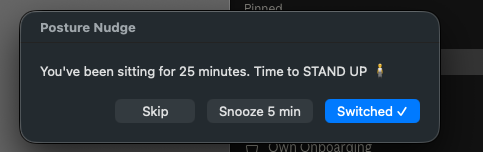

# Posture Nudge

A lightweight macOS background agent that reminds you to switch between sitting and standing after every 25 minutes of active keyboard/mouse use, resetting automatically when you step away.



## Install

```bash
bash install-posture-nudge.sh
```

## Uninstall

```bash
bash install-posture-nudge.sh --uninstall
```
